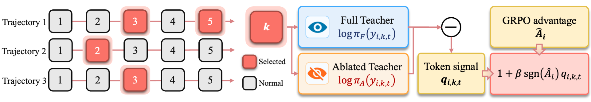

# Agentic Reinforcement Learning with Observation-Calibrated Self-Distillation

<p align="center">
  
</p>

## Requirements

- Linux + CUDA, Python 3.12, 8× A100/H100
- Java 17 for WebShop

## Installation

```bash
conda env create -f environment.yml
conda activate verl-agent
python -m pip install -e . --no-deps
```

Benchmark envs:

```bash
# ALFWorld
python -m pip install alfworld
alfworld-download --data-dir ./data/alfworld

# WebShop
git clone https://github.com/princeton-nlp/webshop.git && cd webshop
./setup.sh -d all

# Search-QA — follow Search-R1 (https://github.com/PeterGriffinJin/Search-R1)
# then launch the retriever
bash examples/search/retriever/retrieval_launch.sh
```

## Quick start

Every experiment is a single self-contained script under
`examples/<algo>_trainer/`. Edit the two placeholder paths at the top
(`MODEL_DIR`, `BASE`), then run:

```bash
bash examples/oc_opsd_trainer/run_alfworld_qwen3_4b.sh
```

Three tasks (ALFWorld / WebShop / Search) × three sizes (Qwen3-1.7B / 4B / 8B)
per method — 9 scripts each.

| Directory                     | Method    |
| ----------------------------- | --------- |
| `examples/oc_opsd_trainer/`   | OC-OPSD   |
| `examples/opsd_trainer/`      | OPSD      |
| `examples/grpo_opsd_trainer/` | GRPO+OPSD |
| `examples/sdar_trainer/`      | SDAR      |
| `examples/rlsd_trainer/`      | RLSD      |
| `examples/grpo_trainer/`      | GRPO      |

## OCSD hyperparameters

Passed via `+algorithm.oc_opsd.*`:

| Key              | Description                                          | Default |
| ---------------- | ---------------------------------------------------- | ------- |
| `beta`           | Calibration strength β on the advantage              | `0.5`   |
| `eps_A`          | Numerical floor on \|A_seq\| in the sign gate         | `1e-6`  |
| `top_step_ratio` | Fraction of highest-NLL steps kept in m_oc           | `0.2`   |
| `env_name`       | `alfworld` / `webshop` / `search`                    | –       |

## Acknowledgements

Built on top of [verl](https://github.com/volcengine/verl) (ByteDance) and
[SDAR](https://github.com/ZJU-REAL/SDAR) (ZJU-REAL). Benchmarks:
[ALFWorld](https://github.com/alfworld/alfworld),
[WebShop](https://github.com/princeton-nlp/webshop),
[Search-R1](https://github.com/PeterGriffinJin/Search-R1).

## License

Apache License 2.0.
